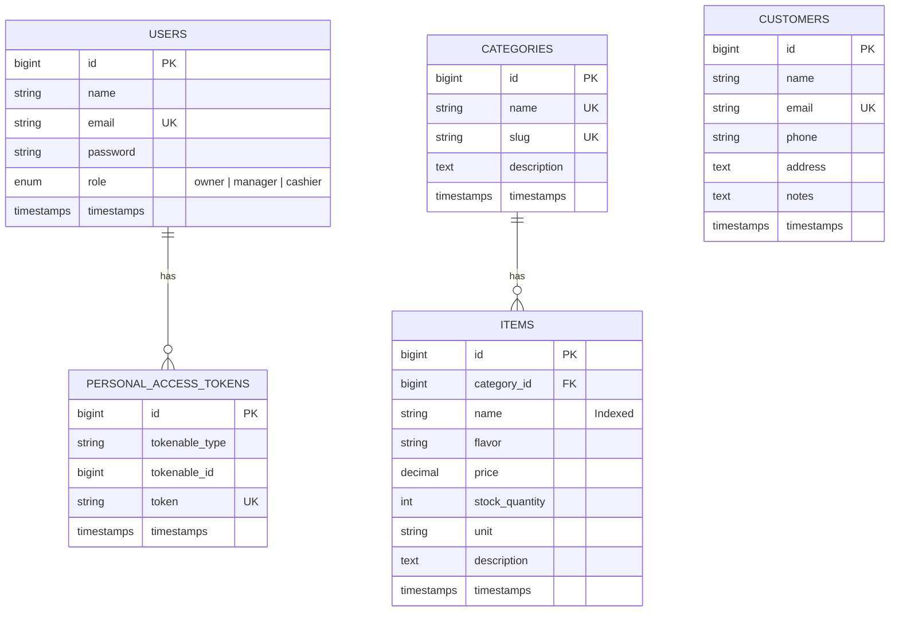

# 🍦 Delivergate - Ice Cream Shop Backend Application

> **Delivergate Technical Assessment - Backend Engineer Intern**  
> Developed using **Laravel (PHP 8.2+)** and **MySQL 8.0** with **Laravel Sanctum Token Authentication** and **Role-Based Access Control (RBAC)**.

---

## 📌 1. Project Overview

This repository contains the production-ready RESTful backend application for an ice cream shop that sells various flavors (such as Chocolate, Vanilla, Strawberry, and Mango). It manages inventory stock and customer records while strictly enforcing **Role-Based Access Control (RBAC)** across three distinct roles: **Owner**, **Manager**, and **Cashier**.

---

## 🚀 2. Technology Stack

- **Framework**: Laravel 11 / 13 (RESTful API architecture)
- **Language**: PHP 8.2+
- **Database**: MySQL 8.0+
- **Authentication**: Laravel Sanctum (Bearer Token Authentication)
- **Testing**: PHPUnit / Laravel Feature & Unit Tests (16 Automated Tests)
- **API Tooling**: Postman Collection v2.1

---

## 🔐 3. Role-Based Access Control (RBAC) Matrix

| Operation | Endpoint | Owner | Manager | Cashier |
| :--- | :--- | :---: | :---: | :---: |
| **Login / Logout** | `POST /api/auth/*` | ✅ | ✅ | ✅ |
| **View Items** | `GET /api/items`, `GET /api/items/{id}` | ✅ | ✅ | ✅ |
| **Create Item** | `POST /api/items` | ✅ | ✅ | ❌ *(403 Forbidden)* |
| **Update Item** | `PUT/PATCH /api/items/{id}` | ✅ | ✅ | ✅ |
| **Delete Item** | `DELETE /api/items/{id}` | ✅ | ❌ *(403 Forbidden)* | ❌ *(403 Forbidden)* |
| **View Customers** | `GET /api/customers`, `GET /api/customers/{id}` | ✅ | ✅ | ✅ |
| **Create Customer** | `POST /api/customers` | ✅ | ✅ | ✅ |
| **Update Customer** | `PUT/PATCH /api/customers/{id}` | ✅ | ✅ | ✅ |
| **Delete Customer** | `DELETE /api/customers/{id}` | ✅ | ❌ *(403 Forbidden)* | ❌ *(403 Forbidden)* |

---

## 🗄️ 4. Database Schema & Entity Relationship Diagram



> An interactive HTML version of this diagram is located in [`docs/er_diagram.html`](docs/er_diagram.html).

---

## 🛠️ 5. Installation & Local Setup

### **Prerequisites**
- **PHP** >= 8.2 with `pdo_mysql`, `mbstring`, `openssl` extensions enabled
- **Composer** (v2+)
- **MySQL Server** (v8.0+)
- **Git**

### **Step 1: Clone Repository**
```bash
git clone https://github.com/FlorinNatha/Ice-Cream-Shop-Backend.git
cd Ice-Cream-Shop-Backend
```

### **Step 2: Install PHP Dependencies**
```bash
composer install
```

### **Step 3: Environment Configuration**
Copy the template configuration file:
```bash
cp .env.example .env
```
Open `.env` and verify your MySQL connection details:
```env
DB_CONNECTION=mysql
DB_HOST=127.0.0.1
DB_PORT=3306
DB_DATABASE=icecream_shop_db
DB_USERNAME=root
DB_PASSWORD=your_mysql_password
```

### **Step 4: Generate Application Key**
```bash
php artisan key:generate
```

### **Step 5: Create MySQL Database & Run Seeders**
Make sure MySQL is running, then create the database (if not already existing) and run migrations with seed data:
```bash
# Optional: create DB from MySQL CLI if not already created
mysql -u root -p -e "CREATE DATABASE IF NOT EXISTS icecream_shop_db;"

# Run migrations and seeders
php artisan migrate --seed
```

### **Step 6: Start Local Development Server**
```bash
php artisan serve
```
The API server will be accessible at: `http://127.0.0.1:8000`

---

## 🔑 6. Pre-Seeded Default Accounts

The database seeders (`php artisan db:seed`) automatically create the following test accounts:

| Role | Email Address | Password | Permissions Summary |
| :--- | :--- | :--- | :--- |
| **Owner** | `owner@delivergate.lk` | `password123` | Full access: CRUD on all Items and Customers |
| **Manager** | `manager@delivergate.lk` | `password123` | CRUD on Customers (no delete), Add/Edit/View Items (no delete) |
| **Cashier** | `cashier@delivergate.lk` | `password123` | CRUD on Customers (no delete), View & Edit Items only (no add/delete) |

---

## 📡 7. API Endpoints Reference

All protected endpoints require the HTTP header:
```http
Authorization: Bearer <your_token>
Accept: application/json
```

### **Authentication**
- `POST /api/auth/login` - Authenticate with email & password, receives token and role.
- `POST /api/auth/logout` - Revokes current user token (Protected).
- `GET /api/auth/me` - Retrieve current authenticated user profile (Protected).

### **Inventory Management**
- `GET /api/items` - List all inventory items (Supports `?name=Chocolate` or `?search=Strawberry`).
- `GET /api/items/{id}` - View single item details.
- `POST /api/items` - Create a new inventory item (*Owner & Manager only*).
- `PUT/PATCH /api/items/{id}` - Update item details (*Owner, Manager, & Cashier*).
- `DELETE /api/items/{id}` - Delete an item (*Owner only*).

### **Customer Management**
- `GET /api/customers` - List all customers (Supports `?search=John`).
- `GET /api/customers/{id}` - View single customer details.
- `POST /api/customers` - Create customer record (*Owner, Manager, & Cashier*).
- `PUT/PATCH /api/customers/{id}` - Update customer record (*Owner, Manager, & Cashier*).
- `DELETE /api/customers/{id}` - Delete customer record (*Owner only*).

### **Categories Helper**
- `GET /api/categories` - List all flavor categories (Chocolate, Vanilla, Strawberry, Mango, etc.).

---

## 🧪 8. Automated Tests

The application includes automated feature tests covering authentication, search filtering, and the complete RBAC matrix:

```bash
php artisan test
```

### Test Suite Summary:
- **`AuthTest`**:
  - `test_user_can_login_with_valid_credentials`
  - `test_user_cannot_login_with_invalid_credentials`
  - `test_authenticated_user_can_logout`
- **`ItemPermissionTest`**:
  - `test_all_roles_can_view_items`
  - `test_owner_and_manager_can_create_item`
  - `test_cashier_cannot_create_item` (asserts 403)
  - `test_all_roles_can_update_item`
  - `test_only_owner_can_delete_item` (asserts 403 for Manager & Cashier, 200 for Owner)
  - `test_item_search_by_name`
- **`CustomerPermissionTest`**:
  - `test_all_roles_can_view_customers`
  - `test_all_roles_can_create_customer`
  - `test_all_roles_can_update_customer`
  - `test_only_owner_can_delete_customer` (asserts 403 for Manager & Cashier, 200 for Owner)
  - `test_customer_search_by_keyword`

---

## 📮 9. Postman Collection

A ready-to-import Postman Collection is located in:
[`postman/Delivergate_Ice_Cream_Shop_API.postman_collection.json`](postman/Delivergate_Ice_Cream_Shop_API.postman_collection.json)

### Features:
1. Automatic token persistence: Logging in as Owner, Manager, or Cashier automatically saves the bearer token into `{{auth_token}}` variable.
2. All endpoints pre-configured with query parameters and sample JSON bodies.
3. Categorized into organized folders: `1. Authentication`, `2. Inventory Management`, `3. Customer Management`, `4. Categories`.

---

## 📂 10. Repository Structure

```text
├── app/
│   ├── Http/
│   │   ├── Controllers/Api/   # AuthController, ItemController, CustomerController
│   │   ├── Requests/          # StoreItemRequest, UpdateItemRequest, etc.
│   │   └── Resources/         # ItemResource, CustomerResource
│   ├── Models/                # User, Category, Item, Customer
│   └── Policies/              # ItemPolicy, CustomerPolicy (RBAC enforcement)
├── database/
│   ├── migrations/            # Users, Categories, Items, Customers tables
│   └── seeders/               # UserSeeder, CategorySeeder, ItemSeeder, CustomerSeeder
├── docs/
│   ├── er_diagram.mermaid     # Mermaid ER diagram source
│   └── er_diagram.html        # Interactive HTML visualizer
├── postman/
│   └── Delivergate_Ice_Cream_Shop_API.postman_collection.json
├── routes/
│   └── api.php                # RESTful API endpoints
└── tests/
    └── Feature/               # AuthTest, ItemPermissionTest, CustomerPermissionTest
```

---

## 📬 Deliverables Checklist
- [x] Complete source code on public GitHub repository
- [x] `.env.example` template configuration
- [x] Database migrations and seed data
- [x] Token authentication & Role-Based Access Control (RBAC)
- [x] Name search filtering on inventory items
- [x] Automated test suite (16 tests, 100% passing)
- [x] Postman API collection
- [x] Entity-Relationship (ER) Diagram (source & interactive visualizer)
- [x] Detailed `README.md`
